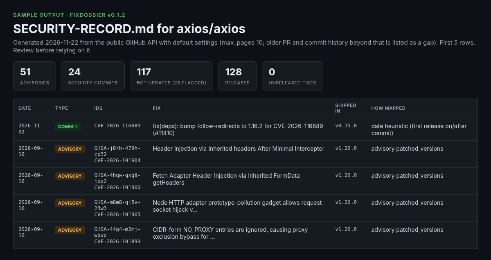

# fixdossier

[](https://github.com/itulo/fixdossier/releases/latest)
[](LICENSE)
[](https://fixdossier.dev/docs/)

A free GitHub Action that writes down what your repo already knows: **when you fixed the security issues GitHub can see, and which release shipped each fix**, plus a `SUPPORT.md` with a support-until date per release. It's engineering evidence for software makers facing the EU Product Liability Directive (EU) 2024/2853 and the Cyber Resilience Act (EU) 2024/2847. Not legal advice, not a compliance certificate, and the record can be incomplete.



**Try it in 2 lines**: add these steps to any job whose token has `contents: read` and `pull-requests: read`:
```yaml
- uses: actions/checkout@v4
- uses: itulo/fixdossier@v0
```
→ The three files are uploaded as a build artifact named `security-record` (default `mode: artifact`). See [real sample records](https://fixdossier.dev/docs/samples/) · [examples/](examples/) · [docs](https://fixdossier.dev/docs/) · [hosted review demo, no login](https://app.fixdossier.dev/demo)

⭐ If this is useful, a star helps others find it.

On each run it reads your repository's:
- releases and tags
- published GitHub security advisories (GHSA) for the repo
- merged Dependabot and Renovate PRs
- commits whose messages look like security fixes (`CVE-…`, `GHSA-…`, "security", "vuln", XSS/SSRF/RCE…)

It then generates:
- **`SECURITY-RECORD.md`**: a dated log of security fixes, each mapped to the release that shipped it, plus bot dependency updates and a release list
- **`security-record.json`**: the same data, machine-readable (`schema: fixdossier/v1`)
- **`SUPPORT.md`**: a support-period policy built from your inputs (`support_period_months`, `eol_date`, `contact`), with a per-release "supported until" table

See [`examples/`](examples/) for real output from axios/axios, fastify/fastify and vitejs/vite.

## Usage
```yaml
permissions:
  contents: write        # commit mode; artifact mode needs only contents: read
  pull-requests: read
steps:
  - uses: actions/checkout@v4
    with:
      ref: ${{ github.event.repository.default_branch }}   # needed for mode: commit on release-triggered runs
  - uses: itulo/fixdossier@v0
    with:
      support_period_months: 24
      eol_date: '2030-12-31'
      contact: security@example.com
      mode: commit                    # artifact (default) | commit | none
```
Full example: [`examples/workflow.yml`](examples/workflow.yml) (runs on release, weekly, and on demand).

| Input | Default | Notes |
|---|---|---|
| `token` | `github.token` | GITHUB_TOKEN is enough |
| `repo` | current repo | `owner/name` |
| `support_period_months` | `12` | security-update window per release |
| `eol_date` | — | caps every window (YYYY-MM-DD) |
| `contact` | — | where to report vulnerabilities |
| `product_name` | repo name | |
| `output_dir` | `.` | |
| `max_pages` | `10` | 100 items/page per source |
| `mode` | `artifact` | `artifact`, `commit` or `none` |
| `fail_on_gaps` | `false` | fail if any source was unreadable |
| `pro_upload` | `false` | upload `security-record.json` to fixdossier Pro via GitHub OIDC (`id-token: write`) or `pro_token` |
| `pro_url` | `https://app.fixdossier.dev` | base URL for fixdossier Pro |
| `pro_token` | `''` | optional upload token (`fxd_tok_...`) if not using GitHub Actions OIDC |

Outputs: `record_file`, `json_file`, `support_file`, `fix_count`, `gap_count`.

**Missing permissions:** if a source returns 401/403/404 (or the rate limit is hit), that section is skipped, a workflow warning is printed, and the gap is listed in the record under "Gaps in this record". The run still succeeds unless `fail_on_gaps: true`. In commit mode, a failed push (no `contents: write`, branch protection) becomes a warning, not a failure.

## Why run it before 9 December 2026
The EU Product Liability Directive **(EU) 2024/2853** treats software as a product. It applies to products placed on the market or put into service after 8 December 2026, i.e. from 9 December 2026 (Art. 2(1), as corrected on 7 May 2026). At the request of a claimant who has shown the claim is plausible, a defendant can be required to disclose relevant evidence (Art. 9(1)), and defectiveness is presumed if it is not disclosed (Art. 10(2)(a), rebuttable). The Cyber Resilience Act **(EU) 2024/2847** requires manufacturers to determine a support period (Art. 13(8)) and to handle vulnerabilities, including by providing security updates (Annex I Part II); it applies from 11 December 2027, with Article 14 reporting obligations applying from 11 September 2026 (Art. 71(2)).

Running fixdossier once now, in `mode: commit`, gives you a dated snapshot of your release and security-fix history as GitHub shows it. A dated, versioned record of fixes and a published support policy is ordinary engineering hygiene that is useful in either setting. Guides: [PLD dates for software releases](https://fixdossier.dev/docs/pld-placed-on-market-dates-for-software.html) · [PLD evidence checklist](https://fixdossier.dev/docs/pld-evidence-checklist-for-engineers.html)

> **Not legal advice.** fixdossier is an engineering tool. It does not make any product "compliant" or "certified" with the PLD, the CRA or anything else, does not limit liability, and its output may be incomplete or wrong. Each company is responsible for its own compliance. Check the record yourself and ask a lawyer about your situation.

## fixdossier Pro (optional hosted workspace & signed Evidence Packs)

The GitHub Action is free and MIT-licensed. **[fixdossier Pro](https://app.fixdossier.dev)** ([interactive demo](https://app.fixdossier.dev/demo)) is an optional hosted workspace for teams that want:
- **Zero-secret CI ingestion:** upload `security-record.json` directly from GitHub Actions using short-lived GitHub OIDC tokens (`pro_upload: 'true'` with `id-token: write`) — fixdossier Pro never receives your source code (only `security-record.json`: release, advisory and pull-request metadata, plus the first line of security-related commit messages, with the run's repository, commit and workflow identifiers) and never holds tokens to your repositories.
- **Human review & immutable audit trail:** classify candidate rows (`confirmed_security_fix`, `excluded_not_security`, `needs_followup`) with reviewer attribution and rationale in an append-only review ledger.
- **Ed25519-signed Evidence Packs:** export Draft or Final PDF + ZIP bundles (`fixdossier-evidence-pack-*.zip`) containing `pack-manifest.json` with SHA-256 checksums and an Ed25519 signature verifiable at `https://app.fixdossier.dev/api/v1/verify`.

```yaml
permissions:
  contents: read
  pull-requests: read
  security-events: read
  id-token: write

steps:
  - uses: actions/checkout@v4
  - uses: itulo/fixdossier@v0
    with:
      pro_upload: 'true'
```

**Founding Licence:** **€69 one-time, tax included** (Dodo Payments is the merchant of record), for the first 50 GitHub organizations. Each licence covers 1 GitHub organization, up to 3 repositories and 5 reviewers. It stays active for as long as the service runs, with at least 90 days' notice and a full 1-click export on shutdown, and a 14-day refund policy. Questions: [contact@fixdossier.dev](mailto:contact@fixdossier.dev).

## How fixes are mapped to releases
Each row records the method that was actually used. The same strings are written to `SECURITY-RECORD.md` and `security-record.json`:

1. `advisory patched_versions` — each advisory `patched_versions` range is parsed (lower and upper bounds, comma or space between bounds, `||`, `^`, and `~`) and matched to the earliest fetched release tag that satisfies that range. Several bare versions in one value (`11.5.15 12.3.3`, or the same list with commas or `||`) are separate exact versions, each mapped to its own release tag; they are not concatenated. A leading `v` and `name@version` tags are accepted. A plain version tag is used when both it and a `name@version` tag satisfy the range. Every matched release is listed. `release` and `release_date` stay the first match; `matched_releases` lists them all.
2. `tag commit match` — the commit SHA, or a bot pull request's merge SHA, equals the commit a release tag points at. Annotated tags use the peeled commit, not the tag object. A short SHA counts only when it is a unique prefix of at least 7 hex characters of one tag commit.
3. `date heuristic (first release on/after publish)`, `date heuristic (first release on/after commit)`, or `date heuristic (first release on/after merge)` — the first stable release published on or after that date. Used only when the methods above do not match.
4. `unreleased` — a commit or bot pull request matched no release. An advisory that matches nothing and has no usable date is `none`.

## Known limits
- `date heuristic (first release on/after publish|commit|merge)` can be wrong when the fixing release is outside the fetched pages, and for maintenance branches and monorepos with per-package tags.
- Commit detection is keyword-based: silent fixes are missed, and some false positives get in. A `docs` conventional commit (any scope, with or without a colon, such as `docs(cra) #1474` or `docs(security): …`) is skipped unless the message cites a CVE or GHSA. `fix(security): …` still counts. Review the record.
- Only *published* repository advisories are read. Global advisories that affect your dependencies are not, and Dependabot alerts need a token with `security_events` access that GITHUB_TOKEN usually lacks.
- "Security?" on bot PRs is strict: it needs a CVE/GHSA ID, a security label, or a security word in the title.
- History depth is bounded by `max_pages`.

## Feedback
Found a wrong mapping or a missed fix? [Open an issue](https://github.com/itulo/fixdossier/issues/new) with the repo and the advisory or commit. If fixdossier saved you time, a ⭐ helps other teams find it.

## Development
```bash
npm test                                          # unit tests + a real-data fixture
bash scripts/live-test.sh axios/axios             # live run against the public API (anonymous OK; GITHUB_TOKEN raises limits)
```
Zero runtime dependencies; Node 20+.

## Privacy
The Action sends nothing anywhere unless you enable `pro_upload` or set `pro_token`. See the [privacy notice](https://fixdossier.dev/privacy.html) for the website, the Action and fixdossier Pro.

## License
MIT. See [LICENSE](LICENSE).
